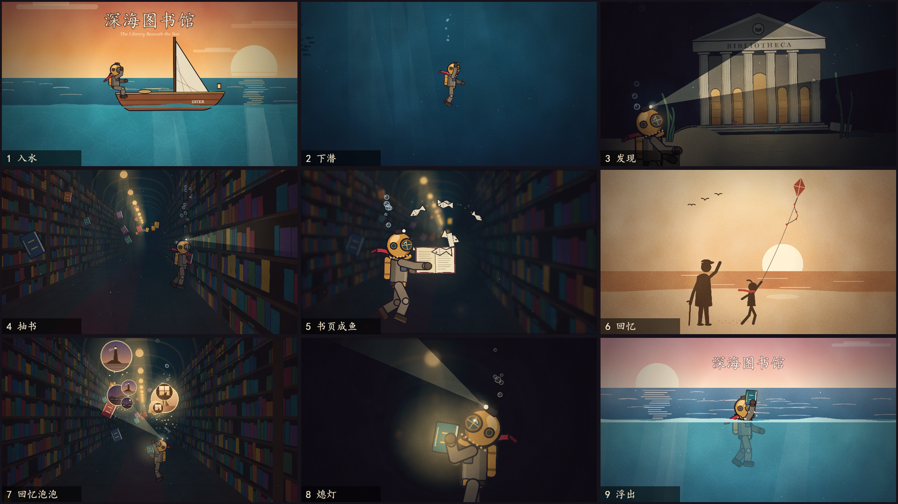

# 深海图书馆 · The Library Beneath the Sea

一支 90 秒的复古插画风动画短片，全部用代码生成：画面用 Canvas 2D（`@napi-rs/canvas`）逐帧绘制，声音用噪声和振荡器在代码里合成，最后由 FFmpeg 编码。

> 一个潜水员沉入海底，发现一座被遗忘的图书馆。书页变成鱼群游走，每本书打开都是一段发光的回忆。最后图书馆的灯一盏盏熄灭，潜水员带着一本书浮出海面。



## ⬇ 下载成片

到 **[Releases 页面](https://github.com/NonoKing123456/deep-sea-library/releases/latest)** 下载：

- `deep-sea-library_v9_1080p24.mp4`：原画质，1920×1080 / 24fps / 90 秒，约 124MB
- `deep-sea-library_v9_1080p24_compressed.mp4`：压缩版，约 36MB

---

- v1–v9 各版本的压缩版视频在 [`exports_compressed/`](exports_compressed/)
- 分镜表：[STORYBOARD.md](STORYBOARD.md)
- 制作过程、每个版本改了什么、自检发现的问题：[PROGRESS.md](PROGRESS.md)

## 运行

需要 Node.js 和 FFmpeg。

```bash
npm install
node src/audio.js audio/mix.wav audio/cues.txt                 # 合成声音（约 3 秒）
node src/render.js 1920 1080 24 out.mp4 audio/mix.wav          # 渲染成片（约 4 分钟）
node src/review.js shots/review                                # 每个镜头 6 帧的审片板
```

## 目录

| 路径 | 内容 |
|---|---|
| `src/scene.js` | 9 个镜头的画面 |
| `src/diver.js` | 潜水员角色（关节式绑定） |
| `src/fx.js` | 光柱、焦散、气泡、浮游粒子、水波、胶片质感 |
| `src/audio.js` | 声音合成与混音 |
| `src/common.js` | 画面和声音共用的时间线 |
| `versions/vN/src` | 每个版本的源码快照 |
| `exports_compressed/` | v1–v9 的压缩版视频（H.264 CRF 23） |
| `shots/` | 制作中的自检截图 |
